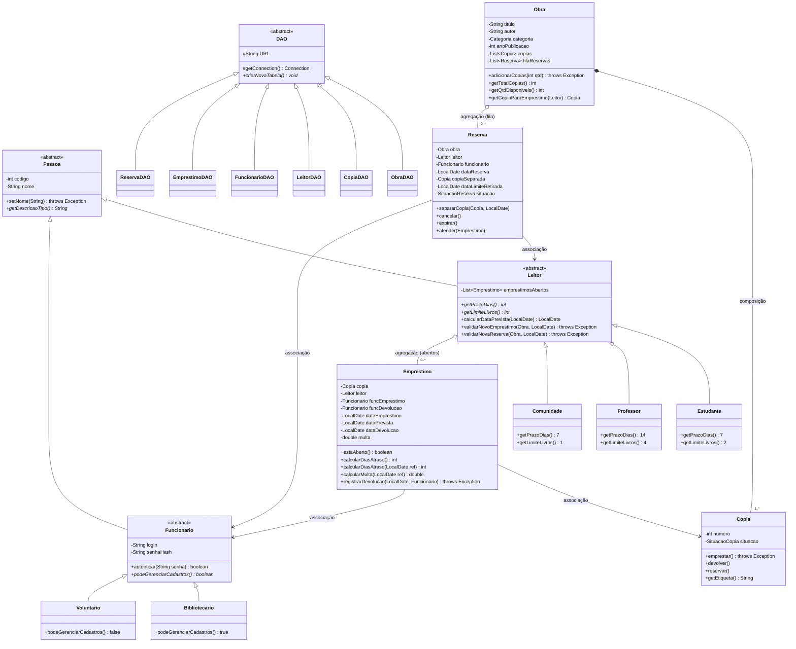
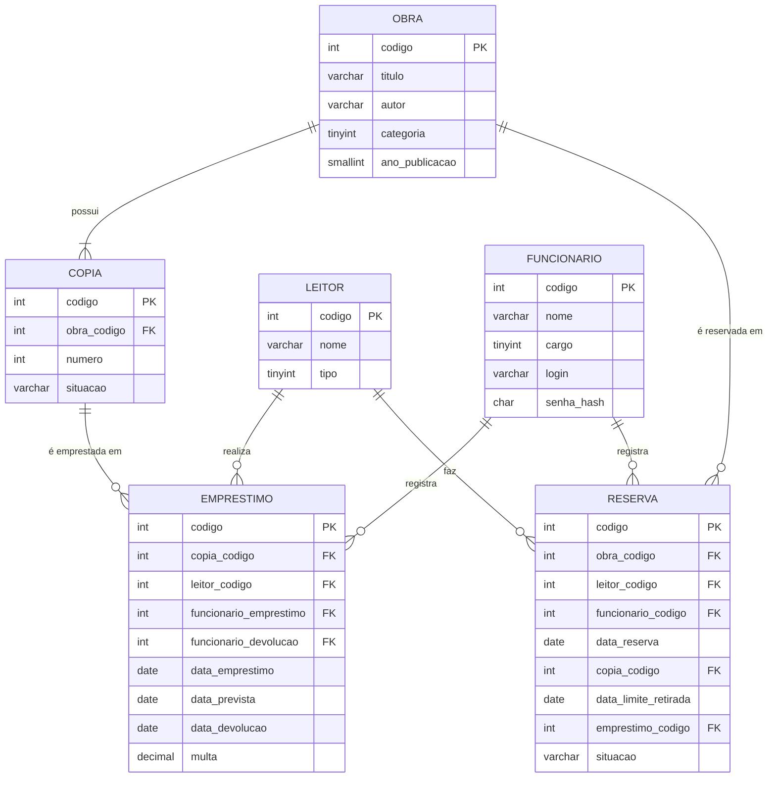

# Proposta v3: Classes Java e Banco MySQL
**Sistema de Biblioteca Comunitária Vila Leitura** (Tema 4, Especificação Cap. 7)

Versão 3 (implementada em `Biblioteca_System`), que segue o padrão do professor de POO (pasta `poo12`) e os requisitos dele (leitores, funcionários, obras, cópias, empréstimos e reservas). As regras do PDF continuam valendo. O que foi acrescentado fica marcado como **[POO]**.

Arquivos:
- `docs/PROPOSTA_ARQUITETURA.md`: este documento
- `docs/schema_biblioteca.sql`: o mesmo SQL que os DAOs executam, **testado no MySQL 8.0.46**
- `docs/seed_exemplo.sql`: dados de exemplo com o mínimo da entrega (15 títulos, 8 leitores, 12 empréstimos e 1 reserva)

---

## 1. O que copiamos do `poo12`

| No `poo12` | No nosso projeto |
|---|---|
| Projeto **Maven**, Java 17, `pom.xml` com o driver JDBC (`sqlite-jdbc`) | Maven, Java 17, dependência `com.mysql:mysql-connector-j`. O `Biblioteca_System` atual (projeto VS Code com `App.java`) vira um projeto Maven. |
| Pacote raiz `com.fatec.poo` com as entidades soltas (`Cliente.java`) | `com.fatec.biblioteca` com as entidades na raiz |
| `com.fatec.poo.dao.ClienteDAO` | `com.fatec.biblioteca.dao.*DAO` |
| `com.fatec.poo.view.Frm*` (`FrmPrincipal`, `FrmCliente`, `FrmConsultaClientes`) | `com.fatec.biblioteca.ui.Frm*` com os mesmos nomes de padrão |
| `Main` cria `FrmPrincipal` e chama `setVisible(true)` | Igual. Antes de abrir, roda a carga e a checagem do RF15 |
| Entidade: atributos `private`, getters e setters, **validação no setter com `throw new Exception(...)`** | Igual. As regras do PDF entram nos setters e nos métodos das entidades |
| DAO: constante `URL`, `DriverManager.getConnection` com try-with-resources, `PreparedStatement`; métodos **`inserir`, `alterar`, `remover`, `carregar(int)`, `listar()`**; **`criarNovaTabela()` no construtor** (`CREATE TABLE IF NOT EXISTS`) | Mesmos nomes de métodos e o mesmo `criarNovaTabela()`. A URL e a conexão ficam numa classe-mãe `DAO` (herança). |
| Formulário de cadastro: `JFrame` com `GridLayout` de `JLabel` e `JTextField`, botões **Consultar, Inserir, Alterar, Excluir, Limpar, Listar**, método `configurarEventos()` com lambdas, `JOptionPane` | Mesmo layout e mesmos botões em `FrmObra`, `FrmLeitor` e `FrmFuncionario` |
| Tela de consulta: `JFrame` + `JTable` + `DefaultTableModel` + botão Atualizar + `carregarDados()` | Mesmo padrão em `FrmConsultaObras`, `FrmConsultaLeitores`, `FrmEmprestimosAbertos` e nos relatórios |
| `FrmPrincipal`: `JMenuBar` com os menus Cadastros, Consultas e Sistema (Sair com confirmação) | Menus **Cadastros, Circulação, Consultas, Relatórios e Sistema** (veja a seção 5) |
| **Não tem camada service**: a tela chama o DAO direto | Também não teremos. As regras ficam nas entidades e a tela só coordena. |

**Uma diferença de propósito:** no `poo12` o `ClienteDAO` captura a exceção e devolve `0`. O requisito escrito do professor pede *"controle de exceções o mais próximo da camada de UI"*. Por isso nossos DAOs declaram **`throws SQLException`** e não capturam nada. Quem faz `try/catch` e mostra o `JOptionPane` é o `Frm`, do mesmo jeito que o `FrmCliente.inserir()` já faz com a `Exception` do setter.

---

## 2. Estrutura de pastas

```
Biblioteca_System/
├── pom.xml                          (Java 17 + mysql-connector-j)
└── src/main/java/com/fatec/biblioteca/
    ├── Main.java
    │   ── entidades (raiz, como Cliente.java) ──
    ├── Pessoa.java                  abstrata
    ├── Leitor.java                  abstrata, extends Pessoa
    ├── Estudante.java  Professor.java  Comunidade.java
    ├── Funcionario.java             abstrata, extends Pessoa       [POO]
    ├── Bibliotecario.java  Voluntario.java                         [POO]
    ├── Obra.java                    (o "livro" do PDF)
    ├── Copia.java                   (exemplar físico)              [POO]
    ├── Emprestimo.java
    ├── Reserva.java                                                [POO]
    ├── Categoria.java  SituacaoCopia.java  SituacaoReserva.java    (enums)
    ├── PerfilUso.java               (matriz 3x5 do PDF)
    ├── ListaCobranca.java           (RF14, gera atrasos_AAAA-MM-DD.txt)
    ├── Datas.java  Validador.java  Sessao.java
    ├── Constantes.java
    ├── dao/
    │   ├── DAO.java                 abstrata: URL, getConnection(), criarNovaTabela()
    │   ├── ObraDAO  CopiaDAO  LeitorDAO  FuncionarioDAO
    │   └── EmprestimoDAO  ReservaDAO
    └── ui/                          (telas Swing)
        ├── FrmPrincipal  FrmLogin
        ├── FrmObra  FrmConsultaObras  FrmAdicionarCopias
        ├── FrmLeitor  FrmConsultaLeitores
        ├── FrmFuncionario  FrmConsultaFuncionarios
        ├── FrmEmprestimo  FrmDevolucao  FrmEmprestimosAbertos
        ├── FrmReserva  FrmConsultaReservas
        └── FrmRelCirculacao  FrmRelAtrasos  FrmRelPerfilUso  FrmExportarCobranca
```

---

## 3. Classes e os 4 conceitos pedidos pelo professor

### 3.1 Diagrama



### 3.2 Onde cada conceito aparece (use na apresentação)

| Conceito exigido | Onde está | Explicação curta |
|---|---|---|
| **Herança** | `Pessoa` → `Leitor` → `Estudante`/`Professor`/`Comunidade`; `Pessoa` → `Funcionario` → `Bibliotecario`/`Voluntario`; `DAO` → 6 DAOs | Código e nome ficam uma vez só em `Pessoa`. A conexão e a URL ficam uma vez só em `DAO`. |
| **Polimorfismo (sobrescrita)** | `getPrazoDias()`/`getLimiteLivros()` em cada tipo de leitor; `podeGerenciarCadastros()` em cada funcionário; `getDescricaoTipo()`; `criarNovaTabela()` em cada DAO | `leitor.calcularDataPrevista(data)` soma 7 dias para um Estudante e 14 para um Professor sem nenhum `if`. Isso substitui os arrays `PRAZO_POR_TIPO`/`LIMITE_POR_TIPO` do PDF. |
| **Polimorfismo (sobrecarga)** | `Emprestimo.calcularDiasAtraso()` e `calcularDiasAtraso(LocalDate ref)` | O primeiro usa a data da devolução e o segundo usa uma data de referência (RN12). |
| **Associação** | `Emprestimo` → `Copia`, `Leitor`, `Funcionario`; `Reserva` → `Leitor`, `Funcionario` | Um objeto usa outro que existe de forma independente. |
| **Agregação** | `Leitor` ◇ `List<Emprestimo> emprestimosAbertos`; `Obra` ◇ `List<Reserva> filaReservas` | O todo guarda a lista, mas as partes existem sozinhas: o empréstimo continua existindo depois de devolvido, e a reserva continua existindo mesmo cancelada. |
| **Composição** (bônus) | `Obra` ◆ `List<Copia>` | Uma cópia não existe sem a obra, e as cópias são criadas pela própria obra em `adicionarCopias()`. |
| **Encapsulamento** | Tudo `private`. A situação da cópia só muda por `emprestar()`/`devolver()`/`reservar()`, nunca por um setter livre. | Garante a RN15. |
| **Classe abstrata** | `Pessoa`, `Leitor`, `Funcionario`, `DAO` | Não existe "pessoa genérica" nem "DAO genérico". |
| **Enum** | `Categoria(1,"Literatura")…`, `SituacaoCopia`, `SituacaoReserva` | Substitui `NOMES_CATEGORIAS` do PDF. |

### 3.3 Onde ficam as regras do PDF (sem camada service, como no `poo12`)

- **Setters com `throws Exception`**, no mesmo estilo do `Cliente.setEmail`:
  - `Obra.setCodigo` faz RN01
  - `setTitulo`/`setAutor` fazem RN02
  - `setCategoria`/`setAnoPublicacao` fazem RN03
  - `Leitor.setCodigo`/`setNome` fazem RN05
  - texto com ";" é recusado (V4.10)
- **`Obra.adicionarCopias(qtd)`** aceita de 1 a 50 por vez e cria as novas cópias com o próximo `numero` (RN04, RF01 e RF02).
- **`Leitor.validarNovoEmprestimo(obra, data)`** usa a própria lista `emprestimosAbertos`:
  - limite do tipo, com a mensagem *"limite de empréstimos simultâneos atingido para o tipo Comunidade"* (RN07)
  - nenhum empréstimo em atraso, com a mensagem *"o leitor possui empréstimo em atraso (nº 3, previsto para 26/02/2026)"* (RN08)
  - nenhum empréstimo em aberto da mesma obra (RN09)
- **`Obra.getCopiaParaEmprestimo(leitor)`** devolve uma cópia `DISPONIVEL`, ou a cópia `RESERVADA` para esse leitor. Se não houver nenhuma, lança *"não há exemplares disponíveis deste livro"* (RN06).
- **`new Emprestimo(copia, leitor, funcionario, data)`** calcula `dataPrevista` chamando `leitor.calcularDataPrevista(data)`, que é polimórfico.
- **`Emprestimo.registrarDevolucao(data, func)`** verifica se o empréstimo está em aberto e se a data não é anterior à do empréstimo (RN11). Depois calcula a multa de R$ 0,50 por dia de atraso (RN12).
- **`EmprestimoDAO.registrarEmprestimo(emp)`** e **`registrarDevolucao(emp)`** usam **uma transação**: gravam o empréstimo e a situação da cópia juntos, ou não gravam nada (RN13, RN16).

**Exemplo de como fica o `FrmEmprestimo.realizar()`** (a exceção é tratada na UI):
```java
private void realizar() {
    try {
        LocalDate data = Datas.converter(txtData.getText());             // dd/mm/aaaa
        reservaDAO.expirarVencidas(data);                                // R6
        Leitor leitor = leitorDAO.carregar(Validador.inteiro(txtLeitor.getText(), "Código do leitor"));
        Obra obra = obraDAO.carregar(Validador.inteiro(txtObra.getText(), "Código do livro"));
        leitor.validarNovoEmprestimo(obra, data);                        // RN07, RN08, RN09
        Reserva reserva = obra.getReservaAguardando(leitor);             // R5
        Copia copia = obra.getCopiaParaEmprestimo(leitor);               // RN06
        Emprestimo emp = new Emprestimo(copia, leitor, Sessao.getFuncionario(), data);
        emprestimoDAO.registrarEmprestimo(emp, reserva);                 // transação
        Mensagem.info(this, "Empréstimo nº " + emp.getCodigo() + " registrado ...");
    } catch (Exception err) {
        Mensagem.erro(this, err);   // SQLException -> "Erro no banco"; regra -> "Verifique!"
    }
}
```

---

## 4. Banco MySQL

| Origem | Tabela | Observação |
|---|---|---|
| `livros.txt` (código, título, autor, categoria, ano) | `obra` | Código digitado (100–9999), como no PDF |
| `livros.txt` (TOTAL, DISPONIVEIS) | `copia` | **Não são mais colunas.** Total = nº de cópias e disponíveis = cópias `DISPONIVEL` |
| `leitores.txt` | `leitor` | `tipo` 1–3. "Empréstimos em aberto" é contado, não fica gravado |
| `emprestimos.txt` | `emprestimo` | Aponta para a **cópia**. Tem o funcionário do empréstimo e o da devolução. `data_devolucao` NULL = em aberto (era 0 no PDF) |
| [POO] | `funcionario` | `cargo` 1 = Bibliotecário, 2 = Voluntário. Login e senha em hash SHA-256 |
| [POO] | `reserva` | Fila por obra, ordenada pelo código |
| `atrasos_dia<N>.txt` | continua arquivo, agora `atrasos_AAAA-MM-DD.txt` | É relatório de mural, não dado (RF14) |
| matriz `emprestimosTipoCategoria` | consulta `GROUP BY` | Preenche a classe `PerfilUso` (`int[3][5]`) |



O banco também protege as regras, com CHECK, FK e índices únicos:
- faixas de código e ano
- textos não vazios
- multa ≥ 0
- devolução ≥ empréstimo
- **uma cópia nunca tem dois empréstimos em aberto**
- **um leitor só tem uma reserva viva por obra**

Testei com o seed do PDF:
- total e disponíveis por obra batem com o `livros.txt` do PDF (101: 3/2, 205: 1/0, 310: 2/1)
- a matriz de perfil bate com o Cenário 3
- a checagem de consistência acha a cópia marcada errada, como no Cenário 4b
- cópia emprestada duas vezes, reserva duplicada e situação inválida foram recusadas

**Como ficam o RF15 e o RF16 com o banco:**
- **RF15:** o `Main` instancia os DAOs, e cada um cria a sua tabela se ela não existir (padrão `poo12`). Depois roda a checagem da RN18: cópia `EMPRESTADA` sem empréstimo aberto, ou cópia com empréstimo aberto que não está `EMPRESTADA`. Cada divergência é corrigida e avisada. Por fim mostra um resumo com a quantidade de registros e o próximo código de empréstimo.
- **RF16:** cada operação já grava na hora, e a mensagem de sucesso só aparece depois do commit.

---

## 5. Telas (`FrmPrincipal` com `JMenuBar`, como no `poo12`)

| Menu | Itens | RFs |
|---|---|---|
| **Cadastros** | Obras (`FrmObra`: consultar, inserir, alterar, excluir, limpar, listar), Adicionar cópias, Leitores, Funcionários *(só Bibliotecário)* | RF01, RF02, RF04, RF06, [POO] |
| **Circulação** | Realizar empréstimo, Registrar devolução, Reservar obra, Cancelar reserva | RF08, RF09, [POO] |
| **Consultas** | Acervo (com filtro de categoria e totais no rodapé), Leitores ("1 de 2"), Empréstimos em aberto (data de referência), Reservas por obra | RF03, RF05, RF07, RF10, [POO] |
| **Relatórios** | Disponíveis e emprestados, Atrasos e multas, Perfil de uso, Exportar lista de cobrança | RF11–RF14 |
| **Sistema** | Trocar funcionário (login), Sair com confirmação | [POO] |

`FrmLogin` abre antes do `FrmPrincipal` e guarda o funcionário logado em `Sessao`. O Voluntário não vê o menu de cadastro de funcionários. Isso é polimorfismo via `podeGerenciarCadastros()`.

---

## 6. Regras propostas para o que o PDF não tem [POO]

**Cópias**
- C1. O RF01 cadastra a obra e cria de 1 a 50 cópias. O RF02 acrescenta mais 1 a 50 (RN04). Cada cópia recebe uma etiqueta `obra-numero` (ex.: `101-3`).
- C2. Situações: `DISPONIVEL`, `EMPRESTADA` e `RESERVADA`. O "total" e os "disponíveis" das telas do PDF são calculados a partir delas.
- C3. O empréstimo é de uma **cópia**. O funcionário digita o código da obra (como no PDF) e o sistema escolhe a cópia sozinho.

**Funcionários**
- F1. Dois cargos. O **Bibliotecário** faz tudo e cadastra funcionários. O **Voluntário** faz circulação, consultas e relatórios, mas não cadastra nem exclui funcionários.
- F2. Cada empréstimo, devolução e reserva grava o funcionário que fez a operação. Isso resolve a "ficha perdida" citada no contexto do PDF.

**Reservas**
- R1. Só dá para reservar uma obra **sem cópia disponível**.
- R2. Quem está bloqueado não reserva: leitor com atraso (mesma ideia da RN08) ou leitor que já tem essa obra emprestada.
- R3. Cada leitor tem no máximo **1 reserva viva por obra**. A reserva **não conta** no limite de empréstimos.
- R4. A fila anda por ordem de chegada. Na devolução, se a obra tem reserva `ATIVA`, a cópia vai para `RESERVADA` em vez de `DISPONIVEL`. A primeira reserva da fila passa para `AGUARDANDO`, com prazo de retirada = data da devolução + **3 dias**.
- R5. Uma cópia `RESERVADA` só pode ser emprestada ao leitor da reserva. Quando ele retira, a reserva vira `ATENDIDA`.
- R6. Se ninguém retirar no prazo, a reserva vira `EXPIRADA` e a cópia vai para o próximo da fila, ou volta a `DISPONIVEL`. Isso é verificado em todo empréstimo, devolução, reserva e cancelamento, usando a data informada.
- R7. O leitor pode cancelar uma reserva a qualquer momento. Se ela já estava `AGUARDANDO`, a cópia é liberada como no R6.

---

## 7. Conflitos com o PDF (e como resolvi)

1. **Livro com quantidades × obra com cópias.** O PDF guarda `TOTAL` e `DISPONIVEIS` como números no livro. Com cópias, esses números passam a ser calculados. As telas e relatórios do PDF (RF03, RF04, RF11) continuam iguais. A RN18 muda de "disponíveis gravado ≠ calculado" para "situação da cópia ≠ empréstimos abertos", mas o aviso continua o mesmo.
2. **RN06 com reservas.** "Exemplar disponível" passa a significar `DISPONIVEL`, ou `RESERVADA` para aquele leitor. No Cenário 2 do PDF nada muda, porque não há reservas.
3. **RF08 e RF09 ganham um dado**, o funcionário responsável. Ele vem do login, então nada novo é digitado.
4. **Editar e excluir.** O `poo12` tem os botões Alterar e Excluir, mas o PDF não tem esses RFs. Proposta: manter os botões. Excluir só é permitido se não houver empréstimos ou reservas, por causa da FK. Senão o erro do banco vira uma mensagem amigável.
5. **Exceções.** O `ClienteDAO` do `poo12` captura as exceções, mas o requisito escrito pede o tratamento perto da UI. Seguimos o requisito escrito.
6. **SQLite × MySQL.** O exemplo usa SQLite. Usamos MySQL, como você pediu. Só muda a URL e a dependência no `pom.xml`. Para o banco ser criado sozinho, a URL usa `createDatabaseIfNotExist=true`.
7. **Capacidades (RN14: 200 obras, 100 leitores, 500 empréstimos).** Mantidas como validação, por fidelidade ao PDF.

---

## 8. Decisões tomadas (respostas de 26/11/2026)

| # | Pergunta | Decisão |
|---|---|---|
| 1 | Regras de reserva (3 dias, não conta no limite) | Aprovadas |
| 2 | Login | Login com senha (hash SHA-256). Primeira execução cria `admin`/`admin` |
| 3 | Permissões do Voluntário | Aprovadas: Voluntário não acessa o cadastro de funcionários |
| 4 | Datas | **`LocalDate`** (no banco, `DATE`). Telas usam dd/mm/aaaa, já preenchidas com a data de hoje |
| 5 | Alterar e excluir | Incluídos, como no `poo12`. Excluir só sem histórico de empréstimos/reservas |
| 6 | Projeto Maven | Sim, no VS Code |
| 7 | Pacote | `com.fatec.biblioteca` |
| 8 | Entidades | Na raiz do pacote, como no `poo12` |
| 9 | Lista de cobrança | Continua gerando `.txt` por enquanto (`atrasos_AAAA-MM-DD.txt`) |
| 10 | Multa | Sem resposta: segue o PDF, só registra. O cálculo está num único método (`Emprestimo.calcularMulta`) e o valor em `Constantes.MULTA_POR_DIA`. Para controlar pagamento depois, basta uma coluna `multa_paga` e um botão |

O que mudou com `LocalDate`:
- RN10: o intervalo 1–365 deixa de existir. A data prevista é `data + prazo` com `plusDays`, então funciona na virada do ano.
- RN12: dias de atraso = `ChronoUnit.DAYS.between(prevista, referência)`, quando positivo.
- `data_devolucao` NULL substitui o `0` do PDF para "em aberto".
- RF14: o arquivo passa a se chamar `atrasos_AAAA-MM-DD.txt`.

## 9. Implementação

Feita em `Biblioteca_System/` (veja o README de lá para rodar). Pequenas diferenças em relação ao `poo12`, todas por causa dos requisitos:
- As tabelas são criadas por `BancoDados.inicializar()` no `Main`, chamando o `criarNovaTabela()` de cada DAO na ordem das chaves estrangeiras (no `poo12` é no construtor, mas lá só existe uma tabela).
- DAOs com `throws SQLException`; as telas tratam tudo com `Mensagem.erro()` (controle de exceções perto da UI).
- Empréstimo, devolução, cadastro de obra e cancelamento de reserva usam transação (`setAutoCommit(false)`, `commit`/`rollback`).

Testado contra MySQL 8.0.46: Cenários 1 a 4 do PDF (datas convertidas), todas as mensagens de bloqueio do Cenário 2, perfil de uso do Cenário 3, correção de consistência do Cenário 4b, lista de cobrança, e o ciclo completo de reserva (fila, separação na devolução, bloqueio para outro leitor, retirada, expiração).
